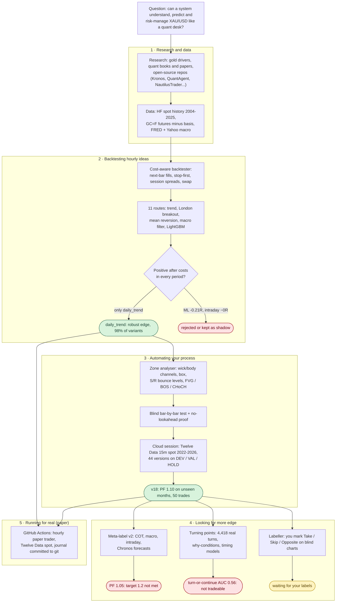
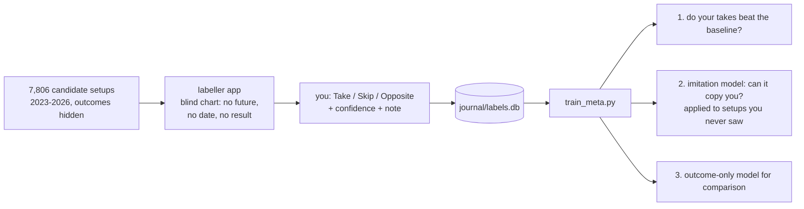

# goldbot: XAU/USD research and paper-trading workhouse

One market, done properly: clean data → realistic backtests → blind tests → paper trading with a full
journal → re-scoring that weights recent evidence more. **Simulation only: nothing here places real orders.**

## Where it stands (30 Oct 2026)
| What | Status |
|---|---|
| `daily_trend` (daily channel breakout with trend filter) | **Only robust edge found**: positive in 2010-18, 2019-22 and 2023-26, 98% of 96 parameter variants positive. Modest: ~8 trades a year. **Active** in paper trading. |
| Zone analyser (your process: wick/body lines, S/R bounce levels, FVG/BOS/CHoCH, 15m close confirmation) | About break-even after costs. Best version `v18` (H4 levels, with the daily trend, 3R): PF 1.10 on unseen months, 50 trades. **Shadow** in paper trading. |
| ML, quant data (COT, macro), forecasting model (Chronos), turning-point learning | Each adds little: PF 1.05 at best on unseen months; turn-or-continue AUC 0.56. |
| Your judgement (labeller) | Not measured yet: the most important open question. |

Main obstacle: 15m stops are ~$5-7 and each trade costs ~$0.50, a 0.10R tax that the setups' ~0.07R raw edge
can't cover. Details: `reports/iterations.md`, `reports/meta_v2_report.md`, `reports/turning_points_report.md`.

## How it was built



Discipline used throughout: every idea was tuned on **DEV** (2023-24), chosen on **VAL** (Jan-Jul 2025) and run
**once** on **HOLD** (Aug 2025 -> Oct 2026), with each HOLD look logged. Tests in `tests/` prove the analyser and
all features give identical decisions when future bars are deleted.

## How it runs every hour

```mermaid
flowchart LR
    CRON(["GitHub Actions<br/>cron :07, Sun-Fri UTC"]) --> SETUP["checkout repo<br/>install pinned deps"]
    SETUP --> FETCH{"TWELVEDATA_API_KEY<br/>secret set?"}
    FETCH -- yes --> TD["Twelve Data<br/>XAU/USD 15m spot"]
    FETCH -- no --> GC["Yahoo GC=F futures<br/>minus measured basis"]
    TD --> STORE[("data/live/<br/>monthly CSVs")]
    GC --> STORE
    HIST[("data/raw/td15<br/>2022-10 → 2026-10")] --> BARS
    STORE --> BARS["15m bars,<br/>completed only"]
    BARS --> H1["hourly bars"]
    MACRO["FRED + Yahoo macro<br/>(refreshed daily)"] --> H1
    H1 --> HR["hourly routes:<br/>daily_trend (active)<br/>+ 8 shadow routes"]
    BARS --> ZR["zone_v18<br/>(15m zone analyser, shadow)"]
    HR --> ENG["backtest engine<br/>same fill and cost rules"]
    ZR --> ENG
    ENG --> J[("journal: runs, signals, trades<br/>closed trades frozen")]
    J --> SC["re-score routes<br/>recent and paper trades weigh more"]
    SC --> OUT["journal/paper.sql<br/>reports/paper_report.md"]
    OUT --> GIT(["commit + push to main"])
    GIT --> YOU["you: read the report on GitHub<br/>or git pull + paper.py report"]
```



- Each run replays every route from `paper_start` (in `config/paper.json`), so a skipped or late GitHub run
  loses nothing: missed candles are fetched and trades are recorded with their true entry times.
- Closed trades never change. If a replay disagrees with a frozen trade, it's logged in `discrepancies`.
- Re-scoring flags `flag_pause` / `flag_promote`; nothing reallocates until you edit `config/paper.json`.
- GitHub's free scheduler can be late or skip runs (4 runs in the first 17 hours instead of 17). No trades are lost.

## Teaching it your judgement



```bash
.venv/bin/python scripts/labeller.py      # http://127.0.0.1:8765
.venv/bin/python scripts/train_meta.py    # -> reports/meta_report.md
```
Aim for 300-500 labels. Commit `journal/labels.db` so Colab and the trainer can use it. See `docs/labeller.md`.

## Setup
```bash
curl -LsSf https://astral.sh/uv/install.sh | sh                    # once
uv venv .venv --python 3.12 && uv pip install --python .venv/bin/python -r requirements.txt
# optional, for forecasting-model features:
uv pip install --python .venv/bin/python --index-url https://download.pytorch.org/whl/cpu torch
uv pip install --python .venv/bin/python -r requirements-ml.txt
```

## Common commands
```bash
git pull                                                  # get the bot's latest journal first
.venv/bin/python scripts/paper.py report                  # paper results (journal rebuilt from paper.sql)
.venv/bin/python scripts/paper.py note "text" --route daily_trend --tags discipline
.venv/bin/python scripts/research.py                      # hourly routes, all periods
.venv/bin/python scripts/blind_test.py --name oct2026 --start 2026-10-01 --end 2026-10-30
.venv/bin/python scripts/zone_research.py v18_v09_h4only  # a zone version on DEV + VAL
.venv/bin/python scripts/train_meta_v2.py --no-hold       # quant/forecast feature sets on DEV + VAL
.venv/bin/python scripts/turning_points.py --no-hold      # turning-point study on DEV + VAL
```
Don't run `scripts/paper.py run` locally: GitHub Actions is the single paper account, and two writers would
diverge. Heavy runs on demand: open `colab/research.ipynb` in Google Colab (File > Open notebook > GitHub,
tick "Include private repos").

## Layout
| Path | What |
|---|---|
| `goldbot/data.py` | History loaders (HF spot, Twelve Data 15m), GC=F basis, FRED/Yahoo macro, all UTC |
| `goldbot/live.py` | Live 15m feed for the paper trader (Twelve Data spot, else GC=F minus basis) |
| `goldbot/costs.py` | Gold spread/commission/slippage/swap model: **edit to match your broker** |
| `goldbot/backtest.py` | Conservative bar-by-bar engine (next-bar fills, stop-first, gaps, breakeven/trail) |
| `goldbot/routes/` | Hourly strategy routes (`rules.py`, `ml.py`, `experimental.py`, `registry.py`) |
| `goldbot/levels.py`, `smc.py`, `analyser.py` | Zone analyser: lines, S/R levels, structure, triggers |
| `goldbot/labelling.py`, `web/labeller.html` | Blind charts, label store, features for the labeller |
| `goldbot/quant_features.py` | COT (CFTC open-data API), lagged macro, intraday structure |
| `goldbot/turning_points.py` | ZigZag pivots, honest labels, causal features, why/lift tables |
| `goldbot/paper.py`, `journal.py`, `scoring.py` | Paper trader, SQLite journal (+ SQL text snapshot), recency scoring |
| `scripts/` | Entry points: research, blind tests, zone research, labeller, trainers, forecasts |
| `config/paper.json` | Active allocation, shadow routes, zone routes, risk, paper start |
| `.github/workflows/paper.yml` | Hourly paper trader (copy in `docs/paper-workflow.yml`) |
| `colab/research.ipynb` | On-demand heavy runs, results pushed to `colab/<date>` branches |
| `journal/` | `paper.sql` (paper account), `blind.db`, `candidates.parquet`, `labels.db`, `turning_points.parquet` |
| `reports/` | Research results, iteration log, holdout logs, paper report |
| `docs/` | `knowledge_base.md`, `routes.md`, `zone_analyser.md`, `labeller.md` |
| `tests/` | No-lookahead proofs, paper replay test |

## Data
- **15m XAU/USD spot, Oct 2022 → today:** Twelve Data chunks in `data/raw/td15` (timestamps were in Sydney time;
  converted to UTC and checked against NFP spikes), then `data/live/` from the hourly bot.
- **Hourly history 2004 → Jul 2025:** Hugging Face mirror of the Kaggle XAUUSD dataset (`scripts/fetch_history.sh`).
  Its timezone (broker time = NY + 7h) was assumed, not verified.
- **Macro:** FRED (real yield, breakevens, fed funds), Yahoo (DXY, VIX, ^TNX). **COT:** CFTC open-data API.
- No real spreads, volume or fills anywhere: costs are modelled in `goldbot/costs.py`.

## Rules before real money
1. At least 100 closed paper trades on the routes you'd trade (one month is not enough).
2. Paper results within the backtest's range (avg R, win rate, costs).
3. Measured costs on a demo account with your broker, not just the model.
4. Start live at 0.25% risk; scale only if live tracks paper.
