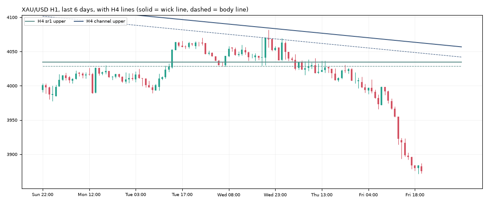

# Gold daily report: Fri 30 Oct 2026

@kaamilstudiesig · **Paper trading only (simulated, no real money).** Trading day: Thu 21:00 → Fri 21:00 UTC.

**XAU/USD 3,875.51** (-146.12 on the day) · last bar Fri 20:45 UTC · data: twelvedata_spot (+0 bars)

## Today's trades

**Opened**

| Route | Side | Entry (UTC) | Entry | Stop | Target | Why |
|---|---|---|---|---|---|---|
| trend_breakout (shadow) | SHORT | 04:00 | 3,992.90 | 4,022.32 | - | RSI 33, ADX 13, ATR $14.7, signal 3:00 UTC |
| trend_breakout+macro (shadow) | SHORT | 04:00 | 3,992.90 | 4,022.32 | - | RSI 33, ADX 13, ATR $14.7, signal 3:00 UTC |
| london_breakout (shadow) | SHORT | 08:00 | 3,971.45 | 4,016.84 | 3,933.55 | RSI 27, ADX 15, ATR $15.1, signal 7:00 UTC |
| london_breakout+macro (shadow) | SHORT | 08:00 | 3,971.45 | 4,016.84 | 3,933.55 | RSI 27, ADX 15, ATR $15.1, signal 7:00 UTC |
| zone_v18 (shadow) | SHORT | 10:15 | 3,983.48 | 4,007.03 | 3,912.84 | breakout, 4h channel lower, candle bear_marubozu, london |
| daily_trend | SHORT | 20:00 | 3,882.70 | 4,043.29 | - | RSI 19, ADX 38, ATR $17.5, signal 19:00 UTC |
| daily_trend+macro (shadow) | SHORT | 20:00 | 3,882.70 | 4,043.29 | - | RSI 19, ADX 38, ATR $17.5, signal 19:00 UTC |

**Closed**

| Route | Side | Entry | Exit | Result | Reason |
|---|---|---|---|---|---|
| london_breakout (shadow) | SHORT | 3,971.45 | 3,933.55 | **+0.83R** ($+42) | target |
| london_breakout+macro (shadow) | SHORT | 3,971.45 | 3,933.55 | **+0.83R** ($+42) | target |
| zone_v18 (shadow) | SHORT | 3,983.48 | 3,912.84 | **+3.00R** ($+150) | target |

## Open positions

| Route | Side | Since (UTC) | Entry | Stop | Now | Open R | To stop |
|---|---|---|---|---|---|---|---|
| trend_breakout (shadow) | SHORT | Fri 04:00 | 3,992.90 | 4,022.32 | 3,875.51 | +3.99R | $146.81 |
| trend_breakout+macro (shadow) | SHORT | Fri 04:00 | 3,992.90 | 4,022.32 | 3,875.51 | +3.99R | $146.81 |
| daily_trend | SHORT | Fri 20:00 | 3,882.70 | 4,043.29 | 3,875.51 | +0.04R | $167.78 |
| daily_trend+macro (shadow) | SHORT | Fri 20:00 | 3,882.70 | 4,043.29 | 3,875.51 | +0.04R | $167.78 |

## Scorecard

Paper account (portfolio routes only): **$10,002.22** (closed +0.00, open +2.22) since 2026-10-30.

Closed trades since the start:

| Route | Trades | Win | Avg R | Total R |
|---|---|---|---|---|
| london_breakout | 1 | 100% | +0.83 | +0.83 |
| london_breakout+macro | 1 | 100% | +0.83 | +0.83 |
| zone_v18 | 1 | 100% | +3.00 | +3.00 |

3 closed trades so far. Nothing is meaningful before ~100.

## Tomorrow's prep

- **Daily trend bias: DOWN** (price below its 100-day average 4,232.07).
- daily_trend triggers: **long** on a 19:00 UTC close above 4,216.21 (and above the 100-day average), **short** below 3,871.18 (and below it). Now +4.32 from the low trigger, -340.70 from the high.
- Macro (30 Oct): 10y real yield 2.63% (-0.28 in 20 days), dollar index -0.32% in 20 days, VIX 19.4. Falling yields and a weaker dollar usually support gold.

**Lines the analyser sees now** (nearest first):

| TF | Kind | Side | Wick line | Body line | Touches | Distance |
|---|---|---|---|---|---|---|
| 4h | sr1 | upper | 4,034.68 | 4,028.58 | 3 | +159.17 |
| 1h | sr1 | upper | 4,036.49 | 4,030.21 | 4 | +160.98 |
| 4h | channel | upper | 4,062.58 | 4,047.66 | 3 | +187.07 |
| 1h | channel | upper | 4,175.04 | 4,162.07 | 3 | +299.53 |

**Watch windows (Mon 02 Nov, UTC):** London open 07:00-09:00 (fake-out risk), US data 12:30 / 13:30, NY open 13:30-14:30, rollover 21:00-22:00 (wide spreads).

---
Generated by the paper-trading bot. Simulation with modelled costs; not investment advice.
