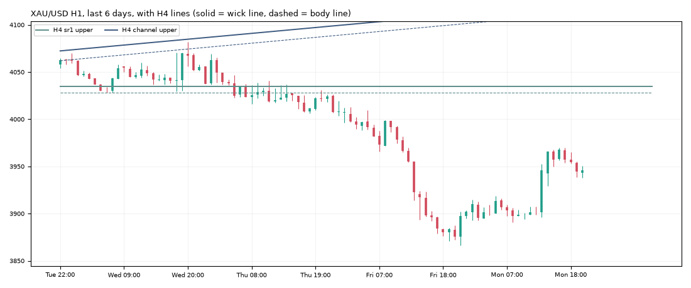

# Gold daily report: Mon 02 Nov 2026

@kaamilstudiesig · **Paper trading only (simulated, no real money).** Trading day: Fri 21:00 → Mon 21:00 UTC.

**XAU/USD 3,946.08** (+70.57 on the day) · last bar Mon 20:45 UTC · data: twelvedata_spot (+1 bars)

## Today's trades

**Closed**

| Route | Side | Entry | Exit | Result | Reason |
|---|---|---|---|---|---|
| trend_breakout (shadow) | SHORT | 3,992.90 | 3,920.19 | **+2.46R** ($+123) | stop |

## Open positions

| Route | Side | Since (UTC) | Entry | Stop | Now | Open R | To stop |
|---|---|---|---|---|---|---|---|
| trend_breakout+macro (shadow) | SHORT | Fri 04:00 | 3,992.90 | 4,022.32 | 3,946.08 | +1.59R | $76.24 |
| daily_trend | SHORT | Fri 20:00 | 3,882.70 | 4,043.29 | 3,946.08 | -0.39R | $97.21 |
| daily_trend+macro (shadow) | SHORT | Fri 20:00 | 3,882.70 | 4,043.29 | 3,946.08 | -0.39R | $97.21 |

## Scorecard

Paper account (portfolio routes only): **$9,978.71** (closed +0.00, open -21.29) since 2026-10-30.

Closed trades since the start:

| Route | Trades | Win | Avg R | Total R |
|---|---|---|---|---|
| london_breakout | 1 | 100% | +0.83 | +0.83 |
| london_breakout+macro | 1 | 100% | +0.83 | +0.83 |
| trend_breakout | 1 | 100% | +2.46 | +2.46 |
| zone_v18 | 1 | 100% | +3.00 | +3.00 |

Flags (you decide, by editing `config/paper.json`): zone_v18 → flag_promote

4 closed trades so far. Nothing is meaningful before ~100.

## Tomorrow's prep

- **Daily trend bias: DOWN** (price below its 100-day average 4,228.77).
- daily_trend triggers: **long** on a 19:00 UTC close above 4,216.21 (and above the 100-day average), **short** below 3,866.02 (and below it). Now +80.06 from the low trigger, -270.13 from the high.
- Macro (02 Nov): 10y real yield 2.60% (-0.31 in 20 days), dollar index -0.34% in 20 days, VIX 21.1. Falling yields and a weaker dollar usually support gold.

**Lines the analyser sees now** (nearest first):

| TF | Kind | Side | Wick line | Body line | Touches | Distance |
|---|---|---|---|---|---|---|
| 1h | channel | upper | 3,967.30 | 3,958.80 | 3 | +21.22 |
| 4h | sr1 | upper | 4,034.68 | 4,028.47 | 3 | +88.60 |
| 4h | channel | upper | 4,123.06 | 4,112.66 | 3 | +176.98 |

**Watch windows (Tue 03 Nov, UTC):** London open 07:00-09:00 (fake-out risk), US data 12:30 / 13:30, NY open 13:30-14:30, rollover 21:00-22:00 (wide spreads).

---
Generated by the paper-trading bot. Simulation with modelled costs; not investment advice.
