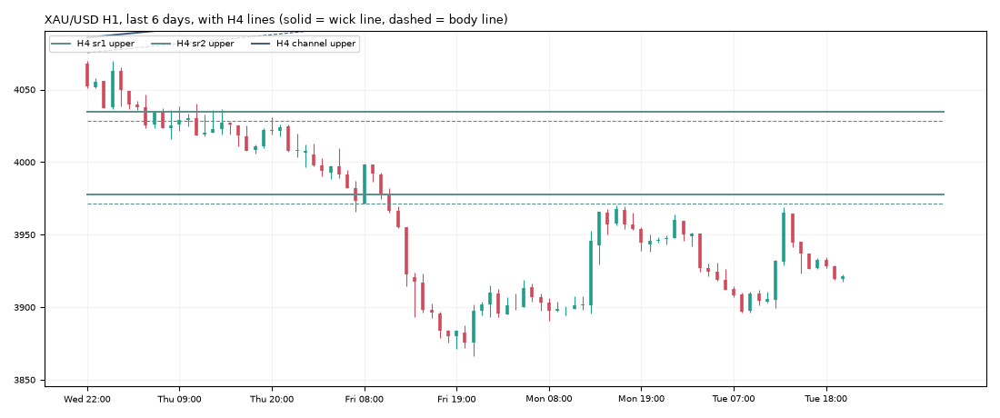

# Gold daily report: Tue 03 Nov 2026

@kaamilstudiesig · **Paper trading only (simulated, no real money).** Trading day: Mon 21:00 → Tue 21:00 UTC.

**XAU/USD 3,921.43** (-26.02 on the day) · last bar Tue 20:45 UTC · data: twelvedata_spot (+7 bars)

## Today's trades

**Opened**

| Route | Side | Entry (UTC) | Entry | Stop | Target | Why |
|---|---|---|---|---|---|---|
| london_breakout (shadow) | SHORT | 08:00 | 3,908.80 | 3,952.35 | 3,857.21 | RSI 38, ADX 22, ATR $14.5, signal 7:00 UTC |

**Closed**

| Route | Side | Entry | Exit | Result | Reason |
|---|---|---|---|---|---|
| london_breakout (shadow) | SHORT | 3,908.80 | 3,952.55 | **-1.01R** ($-51) | stop |

## Open positions

| Route | Side | Since (UTC) | Entry | Stop | Now | Open R | To stop |
|---|---|---|---|---|---|---|---|
| trend_breakout+macro (shadow) | SHORT | Fri 04:00 | 3,992.90 | 4,022.32 | 3,921.43 | +2.43R | $100.89 |
| daily_trend | SHORT | Fri 20:00 | 3,882.70 | 4,043.29 | 3,921.43 | -0.24R | $121.86 |
| daily_trend+macro (shadow) | SHORT | Fri 20:00 | 3,882.70 | 4,043.29 | 3,921.43 | -0.24R | $121.86 |

## Scorecard

Paper account (portfolio routes only): **$9,984.43** (closed +0.00, open -15.57) since 2026-10-30.

Closed trades since the start:

| Route | Trades | Win | Avg R | Total R |
|---|---|---|---|---|
| london_breakout | 2 | 50% | -0.09 | -0.17 |
| london_breakout+macro | 1 | 100% | +0.83 | +0.83 |
| trend_breakout | 1 | 100% | +2.46 | +2.46 |
| zone_v18 | 1 | 100% | +3.00 | +3.00 |

Flags (you decide, by editing `config/paper.json`): zone_v18 → flag_promote

5 closed trades so far. Nothing is meaningful before ~100.

## Tomorrow's prep

- **Daily trend bias: DOWN** (price below its 100-day average 4,226.77).
- daily_trend triggers: **long** on a 19:00 UTC close above 4,216.21 (and above the 100-day average), **short** below 3,866.02 (and below it). Now +55.41 from the low trigger, -294.78 from the high.
- Macro (02 Nov): 10y real yield 2.60% (-0.31 in 20 days), dollar index -0.34% in 20 days, VIX 21.1. Falling yields and a weaker dollar usually support gold.

**Lines the analyser sees now** (nearest first):

| TF | Kind | Side | Wick line | Body line | Touches | Distance |
|---|---|---|---|---|---|---|
| 1h | channel | upper | 3,935.84 | 3,929.86 | 3 | +14.41 |
| 1h | sr1 | upper | 3,969.99 | 3,967.03 | 4 | +48.56 |
| 4h | sr1 | upper | 3,977.58 | 3,971.42 | 3 | +56.15 |
| 4h | sr2 | upper | 4,034.68 | 4,028.51 | 3 | +113.25 |
| 4h | channel | upper | 4,136.57 | 4,126.17 | 3 | +215.14 |

**Watch windows (Wed 04 Nov, UTC):** London open 07:00-09:00 (fake-out risk), US data 12:30 / 13:30, NY open 13:30-14:30, rollover 21:00-22:00 (wide spreads).

---
Generated by the paper-trading bot. Simulation with modelled costs; not investment advice.
