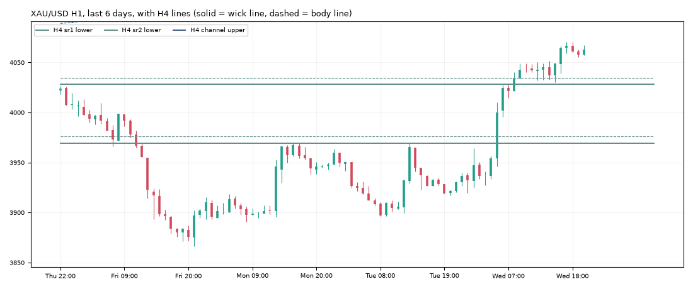

# Gold daily report: Wed 04 Nov 2026

@kaamilstudiesig · **Paper trading only (simulated, no real money).** Trading day: Tue 21:00 → Wed 21:00 UTC.

**XAU/USD 4,062.85** (+140.25 on the day) · last bar Wed 20:45 UTC · data: twelvedata_spot (+15 bars)

## Today's trades

**Closed**

| Route | Side | Entry | Exit | Result | Reason |
|---|---|---|---|---|---|
| daily_trend | SHORT | 3,882.70 | 4,043.49 | **-1.00R** ($-50) | stop |

## Open positions

| Route | Side | Since (UTC) | Entry | Stop | Now | Open R | To stop |
|---|---|---|---|---|---|---|---|
| trend_breakout+macro (shadow) | SHORT | Fri 04:00 | 3,992.90 | 4,022.32 | 4,062.85 | -2.38R | $40.53 |
| daily_trend+macro (shadow) | SHORT | Fri 20:00 | 3,882.70 | 4,043.29 | 4,062.85 | -1.12R | $19.56 |

## Scorecard

Paper account (portfolio routes only): **$9,949.75** (closed -50.25, open +0.00) since 2026-10-30.

Closed trades since the start:

| Route | Trades | Win | Avg R | Total R |
|---|---|---|---|---|
| daily_trend | 1 | 0% | -1.00 | -1.00 |
| london_breakout | 2 | 50% | -0.09 | -0.17 |
| london_breakout+macro | 1 | 100% | +0.83 | +0.83 |
| trend_breakout | 1 | 100% | +2.46 | +2.46 |
| zone_v18 | 1 | 100% | +3.00 | +3.00 |

6 closed trades so far. Nothing is meaningful before ~100.

## Tomorrow's prep

- **Daily trend bias: DOWN** (price below its 100-day average 4,226.36).
- daily_trend triggers: **long** on a 19:00 UTC close above 4,200.45 (and above the 100-day average), **short** below 3,866.02 (and below it). Now +196.83 from the low trigger, -137.60 from the high.
- Macro (04 Nov): 10y real yield 2.65% (-0.13 in 20 days), dollar index -0.66% in 20 days, VIX 16.6. Falling yields and a weaker dollar usually support gold.

**Lines the analyser sees now** (nearest first):

| TF | Kind | Side | Wick line | Body line | Touches | Distance |
|---|---|---|---|---|---|---|
| 4h | sr1 | lower | 4,028.01 | 4,034.82 | 3 | -34.84 |
| 4h | channel | upper | 4,150.08 | 4,139.68 | 3 | +87.23 |
| 4h | sr2 | lower | 3,969.20 | 3,976.01 | 5 | -93.65 |
| 1h | sr1 | lower | 3,963.77 | 3,967.11 | 4 | -99.08 |
| 1h | sr2 | lower | 3,915.02 | 3,918.35 | 3 | -147.83 |

**Watch windows (Thu 05 Nov, UTC):** London open 07:00-09:00 (fake-out risk), US data 12:30 / 13:30, NY open 13:30-14:30, rollover 21:00-22:00 (wide spreads).

---
Generated by the paper-trading bot. Simulation with modelled costs; not investment advice.
