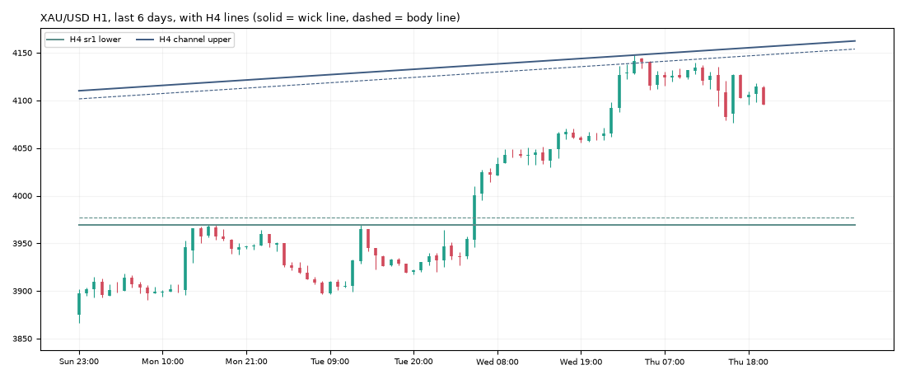

# Gold daily report: Thu 05 Nov 2026

@kaamilstudiesig · **Paper trading only (simulated, no real money).** Trading day: Wed 21:00 → Thu 21:00 UTC.

**XAU/USD 4,096.00** (+30.60 on the day) · last bar Thu 20:45 UTC · data: twelvedata_spot (+7 bars)

## Today's trades

**Opened**

| Route | Side | Entry (UTC) | Entry | Stop | Target | Why |
|---|---|---|---|---|---|---|
| trend_breakout (shadow) | LONG | 04:00 | 4,144.08 | 4,105.57 | - | RSI 85, ADX 55, ATR $19.3, signal 3:00 UTC |
| trend_breakout+macro (shadow) | LONG | 04:00 | 4,144.08 | 4,105.57 | - | RSI 85, ADX 55, ATR $19.3, signal 3:00 UTC |

**Closed**

| Route | Side | Entry | Exit | Result | Reason |
|---|---|---|---|---|---|
| trend_breakout (shadow) | LONG | 4,144.08 | 4,105.37 | **-1.01R** ($-51) | stop |
| trend_breakout+macro (shadow) | LONG | 4,144.08 | 4,105.37 | **-1.01R** ($-50) | stop |

## Open positions

| Route | Side | Since (UTC) | Entry | Stop | Now | Open R | To stop |
|---|---|---|---|---|---|---|---|
| trend_breakout+macro (shadow) | SHORT | Fri 04:00 | 3,992.90 | 4,022.32 | 4,096.00 | -3.50R | $73.68 |
| daily_trend+macro (shadow) | SHORT | Fri 20:00 | 3,882.70 | 4,043.29 | 4,096.00 | -1.33R | $52.71 |

## Scorecard

Paper account (portfolio routes only): **$9,949.75** (closed -50.25, open +0.00) since 2026-10-30.

Closed trades since the start:

| Route | Trades | Win | Avg R | Total R |
|---|---|---|---|---|
| daily_trend | 1 | 0% | -1.00 | -1.00 |
| london_breakout | 2 | 50% | -0.09 | -0.17 |
| london_breakout+macro | 1 | 100% | +0.83 | +0.83 |
| trend_breakout | 2 | 50% | +0.73 | +1.45 |
| trend_breakout+macro | 1 | 0% | -1.01 | -1.01 |
| zone_v18 | 1 | 100% | +3.00 | +3.00 |

8 closed trades so far. Nothing is meaningful before ~100.

## Tomorrow's prep

- **Daily trend bias: DOWN** (price below its 100-day average 4,226.50).
- daily_trend triggers: **long** on a 19:00 UTC close above 4,198.87 (and above the 100-day average), **short** below 3,866.02 (and below it). Now +229.98 from the low trigger, -102.87 from the high.
- Macro (04 Nov): 10y real yield 2.65% (-0.13 in 20 days), dollar index -0.68% in 20 days, VIX 16.6. Falling yields and a weaker dollar usually support gold.

**Lines the analyser sees now** (nearest first):

| TF | Kind | Side | Wick line | Body line | Touches | Distance |
|---|---|---|---|---|---|---|
| 4h | channel | upper | 4,156.32 | 4,147.80 | 3 | +60.32 |
| 4h | sr1 | lower | 3,969.20 | 3,976.74 | 4 | -126.80 |
| 1h | sr1 | lower | 3,963.77 | 3,968.17 | 3 | -132.23 |

**Watch windows (Fri 06 Nov, UTC):** London open 07:00-09:00 (fake-out risk), US data 12:30 / 13:30 (**likely NFP day: first Friday**), NY open 13:30-14:30, rollover 21:00-22:00 (wide spreads).

---
Generated by the paper-trading bot. Simulation with modelled costs; not investment advice.
