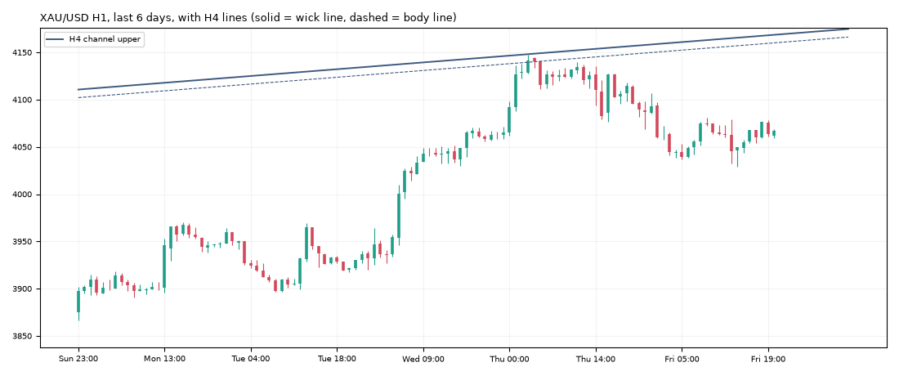

# Gold daily report: Fri 06 Nov 2026

@kaamilstudiesig · **Paper trading only (simulated, no real money).** Trading day: Thu 21:00 → Fri 21:00 UTC.

**XAU/USD 4,067.37** (-21.46 on the day) · last bar Fri 20:45 UTC · data: twelvedata_spot (+0 bars)

## Today's trades

No trades opened or closed today.

## Open positions

| Route | Side | Since (UTC) | Entry | Stop | Now | Open R | To stop |
|---|---|---|---|---|---|---|---|
| trend_breakout+macro (shadow) | SHORT | Fri 04:00 | 3,992.90 | 4,022.32 | 4,067.37 | -2.53R | $45.05 |
| daily_trend+macro (shadow) | SHORT | Fri 20:00 | 3,882.70 | 4,043.29 | 4,067.37 | -1.15R | $24.08 |

## Scorecard

Paper account (portfolio routes only): **$9,949.75** (closed -50.25, open +0.00) since 2026-10-30.

Closed trades since the start:

| Route | Trades | Win | Avg R | Total R |
|---|---|---|---|---|
| daily_trend | 1 | 0% | -1.00 | -1.00 |
| london_breakout | 2 | 50% | -0.09 | -0.17 |
| london_breakout+macro | 1 | 100% | +0.83 | +0.83 |
| trend_breakout | 2 | 50% | +0.73 | +1.45 |
| trend_breakout+macro | 1 | 0% | -1.01 | -1.01 |
| zone_v18 | 1 | 100% | +3.00 | +3.00 |

8 closed trades so far. Nothing is meaningful before ~100.

## Tomorrow's prep

- **Daily trend bias: DOWN** (price below its 100-day average 4,227.07).
- daily_trend triggers: **long** on a 19:00 UTC close above 4,198.87 (and above the 100-day average), **short** below 3,866.02 (and below it). Now +201.35 from the low trigger, -131.49 from the high.
- Macro (06 Nov): 10y real yield 2.60% (-0.14 in 20 days), dollar index +0.43% in 20 days, VIX 25.6. Falling yields and a weaker dollar usually support gold.

**Lines the analyser sees now** (nearest first):

| TF | Kind | Side | Wick line | Body line | Touches | Distance |
|---|---|---|---|---|---|---|
| 1h | sr1 | upper | 4,080.97 | 4,077.35 | 3 | +13.60 |
| 1h | channel | lower | 3,987.98 | 3,992.22 | 3 | -79.39 |
| 4h | channel | upper | 4,168.62 | 4,160.10 | 3 | +101.25 |

**Watch windows (Mon 09 Nov, UTC):** London open 07:00-09:00 (fake-out risk), US data 12:30 / 13:30, NY open 13:30-14:30, rollover 21:00-22:00 (wide spreads).

---
Generated by the paper-trading bot. Simulation with modelled costs; not investment advice.
