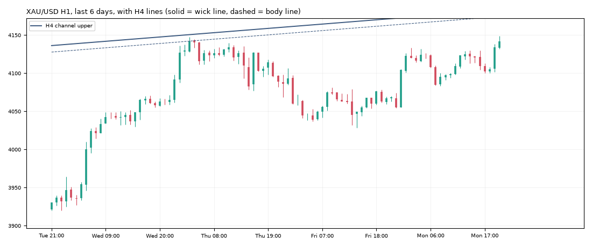

# Gold daily report: Mon 09 Nov 2026

@kaamilstudiesig · **Paper trading only (simulated, no real money).** Trading day: Fri 21:00 → Mon 21:00 UTC.

**XAU/USD 4,142.02** (+75.81 on the day) · last bar Mon 20:45 UTC · data: twelvedata_spot (+19 bars)

## Today's trades

**Opened**

| Route | Side | Entry (UTC) | Entry | Stop | Target | Why |
|---|---|---|---|---|---|---|
| trend_breakout (shadow) | LONG | 01:00 | 4,103.64 | 4,064.06 | - | RSI 61, ADX 18, ATR $19.8, signal 0:00 UTC |
| trend_breakout+macro (shadow) | LONG | 01:00 | 4,103.64 | 4,064.06 | - | RSI 61, ADX 18, ATR $19.8, signal 0:00 UTC |

## Open positions

| Route | Side | Since (UTC) | Entry | Stop | Now | Open R | To stop |
|---|---|---|---|---|---|---|---|
| trend_breakout+macro (shadow) | SHORT | Fri 04:00 | 3,992.90 | 4,022.32 | 4,142.02 | -5.07R | $119.70 |
| daily_trend+macro (shadow) | SHORT | Fri 20:00 | 3,882.70 | 4,043.29 | 4,142.02 | -1.61R | $98.73 |
| trend_breakout (shadow) | LONG | Mon 01:00 | 4,103.64 | 4,064.06 | 4,142.02 | +0.97R | $77.96 |
| trend_breakout+macro (shadow) | LONG | Mon 01:00 | 4,103.64 | 4,064.06 | 4,142.02 | +0.97R | $77.96 |

## Scorecard

Paper account (portfolio routes only): **$9,949.75** (closed -50.25, open +0.00) since 2026-10-30.

Closed trades since the start:

| Route | Trades | Win | Avg R | Total R |
|---|---|---|---|---|
| daily_trend | 1 | 0% | -1.00 | -1.00 |
| london_breakout | 2 | 50% | -0.09 | -0.17 |
| london_breakout+macro | 1 | 100% | +0.83 | +0.83 |
| trend_breakout | 2 | 50% | +0.73 | +1.45 |
| trend_breakout+macro | 1 | 0% | -1.01 | -1.01 |
| zone_v18 | 1 | 100% | +3.00 | +3.00 |

8 closed trades so far. Nothing is meaningful before ~100.

## Tomorrow's prep

- **Daily trend bias: DOWN** (price below its 100-day average 4,227.94).
- daily_trend triggers: **long** on a 19:00 UTC close above 4,190.13 (and above the 100-day average), **short** below 3,866.02 (and below it). Now +276.00 from the low trigger, -48.10 from the high.
- Macro (09 Nov): 10y real yield 2.63% (-0.11 in 20 days), dollar index -0.17% in 20 days, VIX 19.9. Falling yields and a weaker dollar usually support gold.

**Lines the analyser sees now** (nearest first):

| TF | Kind | Side | Wick line | Body line | Touches | Distance |
|---|---|---|---|---|---|---|
| 4h | channel | upper | 4,182.98 | 4,174.46 | 3 | +40.96 |
| 1h | sr1 | lower | 4,076.84 | 4,080.27 | 5 | -65.18 |

**Watch windows (Tue 10 Nov, UTC):** London open 07:00-09:00 (fake-out risk), US data 12:30 / 13:30, NY open 13:30-14:30, rollover 21:00-22:00 (wide spreads).

---
Generated by the paper-trading bot. Simulation with modelled costs; not investment advice.
