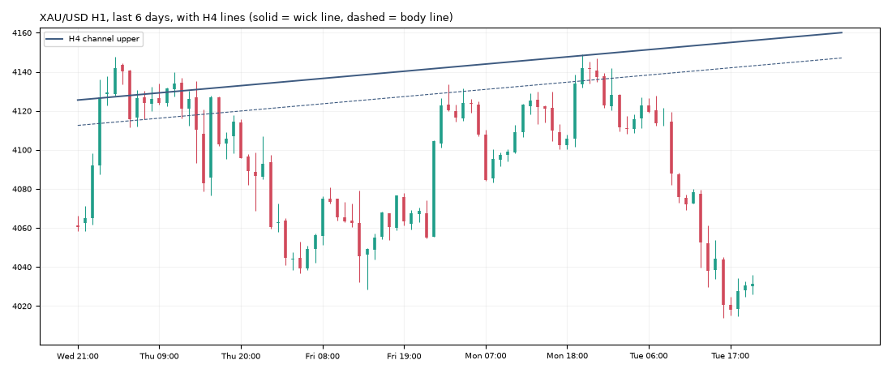

# Gold daily report: Tue 10 Nov 2026

@kaamilstudiesig · **Paper trading only (simulated, no real money).** Trading day: Mon 21:00 → Tue 21:00 UTC.

**XAU/USD 4,031.33** (-106.85 on the day) · last bar Tue 20:45 UTC · data: twelvedata_spot (+1 bars)

## Today's trades

**Opened**

| Route | Side | Entry (UTC) | Entry | Stop | Target | Why |
|---|---|---|---|---|---|---|
| london_breakout (shadow) | SHORT | 10:00 | 4,087.63 | 4,137.16 | 4,053.88 | RSI 39, ADX 16, ATR $16.5, signal 9:00 UTC |
| london_breakout+macro (shadow) | SHORT | 10:00 | 4,087.63 | 4,137.16 | 4,053.88 | RSI 39, ADX 16, ATR $16.5, signal 9:00 UTC |

**Closed**

| Route | Side | Entry | Exit | Result | Reason |
|---|---|---|---|---|---|
| trend_breakout (shadow) | LONG | 4,103.64 | 4,082.45 | **-0.55R** ($-28) | stop |
| trend_breakout+macro (shadow) | LONG | 4,103.64 | 4,082.45 | **-0.55R** ($-27) | stop |
| london_breakout (shadow) | SHORT | 4,087.63 | 4,053.88 | **+0.68R** ($+34) | target |
| london_breakout+macro (shadow) | SHORT | 4,087.63 | 4,053.88 | **+0.68R** ($+34) | target |

## Open positions

| Route | Side | Since (UTC) | Entry | Stop | Now | Open R | To stop |
|---|---|---|---|---|---|---|---|
| trend_breakout+macro (shadow) | SHORT | Fri 04:00 | 3,992.90 | 4,022.32 | 4,031.33 | -1.31R | $9.01 |
| daily_trend+macro (shadow) | SHORT | Fri 20:00 | 3,882.70 | 4,043.29 | 4,031.33 | -0.93R | $11.96 |

## Scorecard

Paper account (portfolio routes only): **$9,949.75** (closed -50.25, open +0.00) since 2026-10-30.

Closed trades since the start:

| Route | Trades | Win | Avg R | Total R |
|---|---|---|---|---|
| daily_trend | 1 | 0% | -1.00 | -1.00 |
| london_breakout | 3 | 67% | +0.17 | +0.51 |
| london_breakout+macro | 2 | 100% | +0.76 | +1.51 |
| trend_breakout | 3 | 33% | +0.30 | +0.90 |
| trend_breakout+macro | 2 | 0% | -0.78 | -1.56 |
| zone_v18 | 1 | 100% | +3.00 | +3.00 |

12 closed trades so far. Nothing is meaningful before ~100.

## Tomorrow's prep

- **Daily trend bias: DOWN** (price below its 100-day average 4,228.35).
- daily_trend triggers: **long** on a 19:00 UTC close above 4,190.13 (and above the 100-day average), **short** below 3,866.02 (and below it). Now +165.31 from the low trigger, -158.80 from the high.
- Macro (09 Nov): 10y real yield 2.63% (-0.11 in 20 days), dollar index -0.17% in 20 days, VIX 19.9. Falling yields and a weaker dollar usually support gold.

**Lines the analyser sees now** (nearest first):

| TF | Kind | Side | Wick line | Body line | Touches | Distance |
|---|---|---|---|---|---|---|
| 1h | channel | lower | 4,012.58 | 4,020.37 | 3 | -18.75 |
| 1h | sr1 | upper | 4,083.16 | 4,079.72 | 4 | +51.83 |
| 1h | sr2 | upper | 4,133.70 | 4,130.01 | 3 | +102.37 |
| 4h | channel | upper | 4,156.05 | 4,143.07 | 3 | +124.72 |

**Watch windows (Wed 11 Nov, UTC):** London open 07:00-09:00 (fake-out risk), US data 12:30 / 13:30, NY open 13:30-14:30, rollover 21:00-22:00 (wide spreads).

---
Generated by the paper-trading bot. Simulation with modelled costs; not investment advice.
