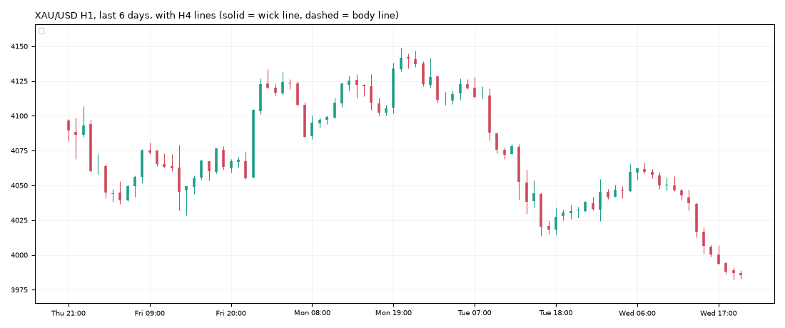

# Gold daily report: Wed 11 Nov 2026

@kaamilstudiesig · **Paper trading only (simulated, no real money).** Trading day: Tue 21:00 → Wed 21:00 UTC.

**XAU/USD 3,985.50** (-45.60 on the day) · last bar Wed 20:45 UTC · data: twelvedata_spot (+7 bars)

## Today's trades

**Opened**

| Route | Side | Entry (UTC) | Entry | Stop | Target | Why |
|---|---|---|---|---|---|---|
| zone_v18 (shadow) | SHORT | 14:45 | 4,018.21 | 4,037.54 | 3,960.21 | breakout, 4h channel lower, candle bear_normal, ny_overlap |

## Open positions

| Route | Side | Since (UTC) | Entry | Stop | Now | Open R | To stop |
|---|---|---|---|---|---|---|---|
| trend_breakout+macro (shadow) | SHORT | Fri 04:00 | 3,992.90 | 4,022.32 | 3,985.50 | +0.25R | $36.82 |
| daily_trend+macro (shadow) | SHORT | Fri 20:00 | 3,882.70 | 4,043.29 | 3,985.50 | -0.64R | $57.79 |
| zone_v18 (shadow) | SHORT | Wed 14:45 | 4,018.21 | 4,037.54 | 3,985.50 | +1.69R | $52.05 |
| trend_breakout (shadow) | SHORT | Thu 00:00 | 3,980.27 | 4,004.95 | 3,985.50 | -0.21R | $19.45 |

## Scorecard

Paper account (portfolio routes only): **$9,949.75** (closed -50.25, open +0.00) since 2026-10-30.

Closed trades since the start:

| Route | Trades | Win | Avg R | Total R |
|---|---|---|---|---|
| daily_trend | 1 | 0% | -1.00 | -1.00 |
| london_breakout | 3 | 67% | +0.17 | +0.51 |
| london_breakout+macro | 2 | 100% | +0.76 | +1.51 |
| trend_breakout | 3 | 33% | +0.30 | +0.90 |
| trend_breakout+macro | 2 | 0% | -0.78 | -1.56 |
| zone_v18 | 1 | 100% | +3.00 | +3.00 |

12 closed trades so far. Nothing is meaningful before ~100.

## Tomorrow's prep

- **Daily trend bias: DOWN** (price below its 100-day average 4,228.11).
- daily_trend triggers: **long** on a 19:00 UTC close above 4,155.90 (and above the 100-day average), **short** below 3,866.02 (and below it). Now +119.48 from the low trigger, -170.40 from the high.
- Macro (10 Nov): 10y real yield 2.66% (-0.10 in 20 days), dollar index +0.44% in 20 days, VIX 19.5. Falling yields and a weaker dollar usually support gold.

**Lines the analyser sees now** (nearest first):

| TF | Kind | Side | Wick line | Body line | Touches | Distance |
|---|---|---|---|---|---|---|
| 1h | channel | upper | 4,037.71 | 4,029.45 | 3 | +52.21 |
| 1h | sr1 | upper | 4,133.70 | 4,130.01 | 3 | +148.20 |

**Watch windows (Thu 12 Nov, UTC):** London open 07:00-09:00 (fake-out risk), US data 12:30 / 13:30, NY open 13:30-14:30, rollover 21:00-22:00 (wide spreads).

---
Generated by the paper-trading bot. Simulation with modelled costs; not investment advice.
