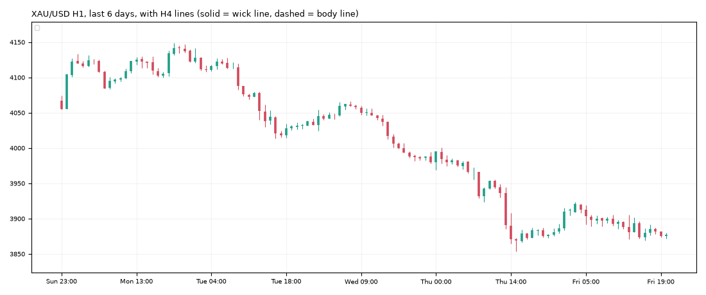

# Gold daily report: Fri 13 Nov 2026

@kaamilstudiesig · **Paper trading only (simulated, no real money).** Trading day: Thu 21:00 → Fri 21:00 UTC.

**XAU/USD 3,877.48** (+5.03 on the day) · last bar Fri 20:45 UTC · data: twelvedata_spot (+1 bars)

## Today's trades

**Closed**

| Route | Side | Entry | Exit | Result | Reason |
|---|---|---|---|---|---|
| trend_breakout (shadow) | SHORT | 3,980.27 | 3,906.25 | **+2.99R** ($+150) | stop |
| trend_breakout+macro (shadow) | SHORT | 3,980.27 | 3,906.25 | **+2.99R** ($+148) | stop |

## Open positions

| Route | Side | Since (UTC) | Entry | Stop | Now | Open R | To stop |
|---|---|---|---|---|---|---|---|
| trend_breakout+macro (shadow) | SHORT | Fri 04:00 | 3,992.90 | 4,022.32 | 3,877.48 | +3.92R | $144.84 |
| daily_trend+macro (shadow) | SHORT | Fri 20:00 | 3,882.70 | 4,043.29 | 3,877.48 | +0.03R | $165.81 |

## Scorecard

Paper account (portfolio routes only): **$9,949.75** (closed -50.25, open +0.00) since 2026-10-30.

Closed trades since the start:

| Route | Trades | Win | Avg R | Total R |
|---|---|---|---|---|
| daily_trend | 1 | 0% | -1.00 | -1.00 |
| london_breakout | 4 | 75% | +0.32 | +1.28 |
| london_breakout+macro | 3 | 100% | +0.76 | +2.29 |
| trend_breakout | 4 | 50% | +0.97 | +3.89 |
| trend_breakout+macro | 3 | 33% | +0.48 | +1.43 |
| zone_v18 | 2 | 100% | +2.99 | +5.99 |

Flags (you decide, by editing `config/paper.json`): london_breakout+macro → flag_promote, zone_v18 → flag_promote

17 closed trades so far. Nothing is meaningful before ~100.

## Tomorrow's prep

- **Daily trend bias: DOWN** (price below its 100-day average 4,225.59).
- daily_trend triggers: **long** on a 19:00 UTC close above 4,149.01 (and above the 100-day average), **short** below 3,853.27 (and below it). Now +24.22 from the low trigger, -271.52 from the high.
- Macro (12 Nov): 10y real yield 2.78% (+0.12 in 20 days), dollar index +1.34% in 20 days, VIX 18.7. Falling yields and a weaker dollar usually support gold.

**Lines the analyser sees now** (nearest first):

| TF | Kind | Side | Wick line | Body line | Touches | Distance |
|---|---|---|---|---|---|---|
| 1h | channel | upper | 3,875.06 | 3,869.89 | 3 | -2.42 |

**Watch windows (Mon 16 Nov, UTC):** London open 07:00-09:00 (fake-out risk), US data 12:30 / 13:30, NY open 13:30-14:30, rollover 21:00-22:00 (wide spreads).

---
Generated by the paper-trading bot. Simulation with modelled costs; not investment advice.
