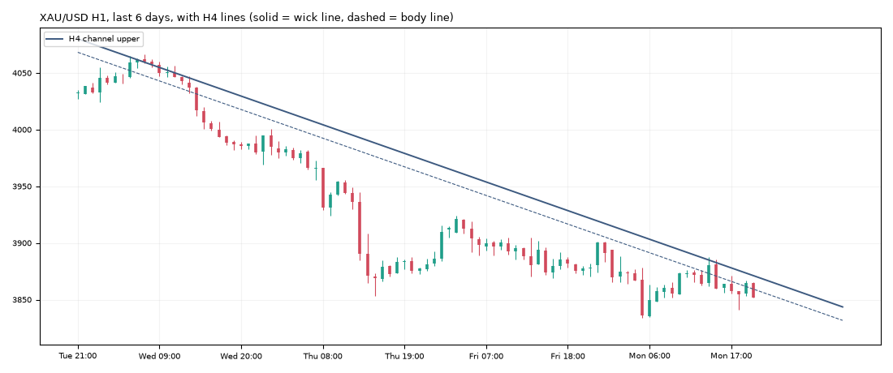

# Gold daily report: Mon 16 Nov 2026

@kaamilstudiesig · **Paper trading only (simulated, no real money).** Trading day: Fri 21:00 → Mon 21:00 UTC.

**XAU/USD 3,851.76** (-20.95 on the day) · last bar Mon 20:45 UTC · data: twelvedata_spot (+7 bars)

## Today's trades

**Opened**

| Route | Side | Entry (UTC) | Entry | Stop | Target | Why |
|---|---|---|---|---|---|---|
| trend_breakout (shadow) | SHORT | 06:00 | 3,835.32 | 3,872.60 | - | RSI 30, ADX 32, ATR $18.6, signal 5:00 UTC |
| trend_breakout+macro (shadow) | SHORT | 06:00 | 3,835.32 | 3,872.60 | - | RSI 30, ADX 32, ATR $18.6, signal 5:00 UTC |

**Closed**

| Route | Side | Entry | Exit | Result | Reason |
|---|---|---|---|---|---|
| trend_breakout (shadow) | SHORT | 3,835.32 | 3,872.80 | **-1.01R** ($-51) | stop |
| trend_breakout+macro (shadow) | SHORT | 3,835.32 | 3,872.80 | **-1.01R** ($-51) | stop |

## Open positions

| Route | Side | Since (UTC) | Entry | Stop | Now | Open R | To stop |
|---|---|---|---|---|---|---|---|
| trend_breakout+macro (shadow) | SHORT | Fri 04:00 | 3,992.90 | 4,022.32 | 3,851.76 | +4.80R | $170.56 |
| daily_trend+macro (shadow) | SHORT | Fri 20:00 | 3,882.70 | 4,043.29 | 3,851.76 | +0.19R | $191.53 |

## Scorecard

Paper account (portfolio routes only): **$9,949.75** (closed -50.25, open +0.00) since 2026-10-30.

Closed trades since the start:

| Route | Trades | Win | Avg R | Total R |
|---|---|---|---|---|
| daily_trend | 1 | 0% | -1.00 | -1.00 |
| london_breakout | 4 | 75% | +0.32 | +1.28 |
| london_breakout+macro | 3 | 100% | +0.76 | +2.29 |
| trend_breakout | 5 | 40% | +0.58 | +2.88 |
| trend_breakout+macro | 4 | 25% | +0.11 | +0.43 |
| zone_v18 | 2 | 100% | +2.99 | +5.99 |

Flags (you decide, by editing `config/paper.json`): london_breakout+macro → flag_promote, zone_v18 → flag_promote

19 closed trades so far. Nothing is meaningful before ~100.

## Tomorrow's prep

- **Daily trend bias: DOWN** (price below its 100-day average 4,220.99).
- daily_trend triggers: **long** on a 19:00 UTC close above 4,149.01 (and above the 100-day average), **short** below 3,833.62 (and below it). Now +18.14 from the low trigger, -297.25 from the high.
- Macro (16 Nov): 10y real yield 2.91% (+0.25 in 20 days), dollar index +1.75% in 20 days, VIX 22.9. Falling yields and a weaker dollar usually support gold.

**Lines the analyser sees now** (nearest first):

| TF | Kind | Side | Wick line | Body line | Touches | Distance |
|---|---|---|---|---|---|---|
| 4h | channel | upper | 3,871.13 | 3,859.25 | 3 | +19.37 |
| 1h | channel | upper | 3,888.27 | 3,877.48 | 4 | +36.51 |
| 1h | sr1 | upper | 3,905.03 | 3,901.71 | 3 | +53.27 |
| 1h | box | upper | 3,905.03 | 3,900.01 | 3 | +53.27 |
| 1h | channel | lower | 3,795.91 | 3,805.23 | 3 | -55.85 |

**Watch windows (Tue 17 Nov, UTC):** London open 07:00-09:00 (fake-out risk), US data 12:30 / 13:30, NY open 13:30-14:30, rollover 21:00-22:00 (wide spreads).

---
Generated by the paper-trading bot. Simulation with modelled costs; not investment advice.
