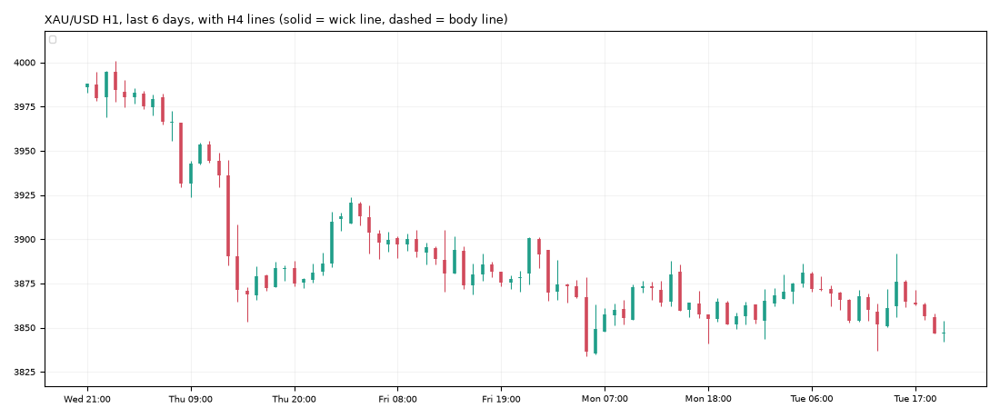

# Gold daily report: Tue 17 Nov 2026

@kaamilstudiesig · **Paper trading only (simulated, no real money).** Trading day: Mon 21:00 → Tue 21:00 UTC.

**XAU/USD 3,846.98** (-5.09 on the day) · last bar Tue 20:45 UTC · data: twelvedata_spot (+1 bars)

## Today's trades

No trades opened or closed today.

## Open positions

| Route | Side | Since (UTC) | Entry | Stop | Now | Open R | To stop |
|---|---|---|---|---|---|---|---|
| trend_breakout+macro (shadow) | SHORT | Fri 04:00 | 3,992.90 | 4,022.32 | 3,846.98 | +4.96R | $175.34 |
| daily_trend+macro (shadow) | SHORT | Fri 20:00 | 3,882.70 | 4,043.29 | 3,846.98 | +0.22R | $196.31 |
| trend_breakout (shadow) | SHORT | Wed 01:00 | 3,815.28 | 3,848.64 | 3,846.98 | -0.95R | $1.66 |
| trend_breakout+macro (shadow) | SHORT | Wed 01:00 | 3,815.28 | 3,848.64 | 3,846.98 | -0.95R | $1.66 |

## Scorecard

Paper account (portfolio routes only): **$9,949.75** (closed -50.25, open +0.00) since 2026-10-30.

Closed trades since the start:

| Route | Trades | Win | Avg R | Total R |
|---|---|---|---|---|
| daily_trend | 1 | 0% | -1.00 | -1.00 |
| london_breakout | 4 | 75% | +0.32 | +1.28 |
| london_breakout+macro | 3 | 100% | +0.76 | +2.29 |
| trend_breakout | 5 | 40% | +0.58 | +2.88 |
| trend_breakout+macro | 4 | 25% | +0.11 | +0.43 |
| zone_v18 | 2 | 100% | +2.99 | +5.99 |

Flags (you decide, by editing `config/paper.json`): london_breakout+macro → flag_promote, zone_v18 → flag_promote

19 closed trades so far. Nothing is meaningful before ~100.

## Tomorrow's prep

- **Daily trend bias: DOWN** (price below its 100-day average 4,219.09).
- daily_trend triggers: **long** on a 19:00 UTC close above 4,149.01 (and above the 100-day average), **short** below 3,833.62 (and below it). Now +13.36 from the low trigger, -302.03 from the high.
- Macro (16 Nov): 10y real yield 2.91% (+0.25 in 20 days), dollar index +1.75% in 20 days, VIX 22.9. Falling yields and a weaker dollar usually support gold.

**Lines the analyser sees now** (nearest first):

| TF | Kind | Side | Wick line | Body line | Touches | Distance |
|---|---|---|---|---|---|---|
| 1h | sr1 | lower | 3,837.09 | 3,841.13 | 3 | -9.89 |
| 1h | channel | lower | 3,835.52 | 3,849.77 | 3 | -11.46 |
| 1h | box | lower | 3,833.62 | 3,851.60 | 3 | -13.36 |
| 1h | channel | upper | 3,881.66 | 3,874.19 | 5 | +34.68 |
| 1h | sr1 | upper | 3,891.96 | 3,888.27 | 4 | +44.98 |
| 1h | box | upper | 3,891.96 | 3,880.12 | 3 | +44.98 |

**Watch windows (Wed 18 Nov, UTC):** London open 07:00-09:00 (fake-out risk), US data 12:30 / 13:30, NY open 13:30-14:30, rollover 21:00-22:00 (wide spreads).

---
Generated by the paper-trading bot. Simulation with modelled costs; not investment advice.
