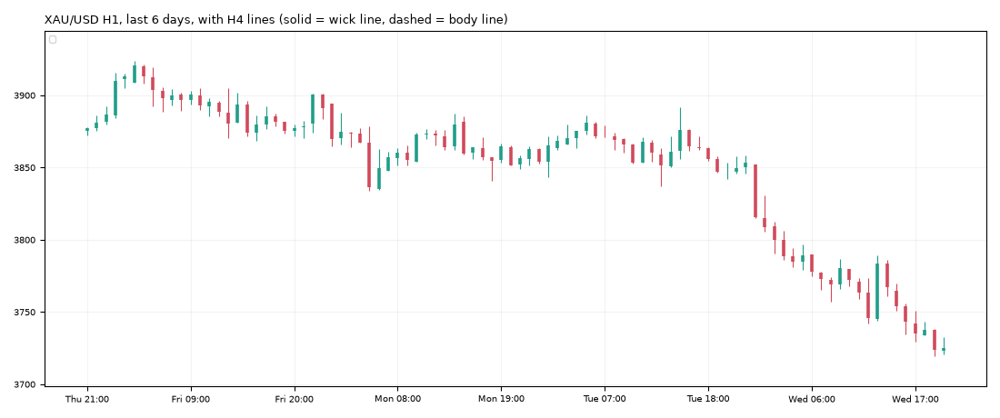

# Gold daily report: Wed 18 Nov 2026

@kaamilstudiesig · **Paper trading only (simulated, no real money).** Trading day: Tue 21:00 → Wed 21:00 UTC.

**XAU/USD 3,724.93** (-124.56 on the day) · last bar Wed 20:45 UTC · data: twelvedata_spot (+2 bars)

## Today's trades

**Opened**

| Route | Side | Entry (UTC) | Entry | Stop | Target | Why |
|---|---|---|---|---|---|---|
| trend_breakout (shadow) | SHORT | 01:00 | 3,815.28 | 3,848.64 | - | RSI 32, ADX 15, ATR $16.7, signal 0:00 UTC |
| trend_breakout+macro (shadow) | SHORT | 01:00 | 3,815.28 | 3,848.64 | - | RSI 32, ADX 15, ATR $16.7, signal 0:00 UTC |
| london_breakout (shadow) | SHORT | 08:00 | 3,772.16 | 3,823.12 | 3,694.21 | RSI 24, ADX 30, ATR $17.0, signal 7:00 UTC |
| london_breakout+macro (shadow) | SHORT | 08:00 | 3,772.16 | 3,823.12 | 3,694.21 | RSI 24, ADX 30, ATR $17.0, signal 7:00 UTC |
| daily_trend | SHORT | 20:00 | 3,723.39 | 3,907.21 | - | RSI 29, ADX 40, ATR $19.4, signal 19:00 UTC |
| daily_trend+macro (shadow) | SHORT | 20:00 | 3,723.39 | 3,907.21 | - | RSI 29, ADX 40, ATR $19.4, signal 19:00 UTC |

**Closed**

| Route | Side | Entry | Exit | Result | Reason |
|---|---|---|---|---|---|
| london_breakout (shadow) | SHORT | 3,772.16 | 3,725.28 | **+0.92R** ($+46) | session_end |
| london_breakout+macro (shadow) | SHORT | 3,772.16 | 3,725.28 | **+0.92R** ($+46) | session_end |

## Open positions

| Route | Side | Since (UTC) | Entry | Stop | Now | Open R | To stop |
|---|---|---|---|---|---|---|---|
| trend_breakout+macro (shadow) | SHORT | Fri 04:00 | 3,992.90 | 4,022.32 | 3,724.93 | +9.11R | $297.39 |
| daily_trend+macro (shadow) | SHORT | Fri 20:00 | 3,882.70 | 4,043.29 | 3,724.93 | +0.98R | $318.35 |
| trend_breakout (shadow) | SHORT | Wed 01:00 | 3,815.28 | 3,848.64 | 3,724.93 | +2.71R | $123.70 |
| trend_breakout+macro (shadow) | SHORT | Wed 01:00 | 3,815.28 | 3,848.64 | 3,724.93 | +2.71R | $123.70 |
| daily_trend | SHORT | Wed 20:00 | 3,723.39 | 3,907.21 | 3,724.93 | -0.01R | $182.27 |
| daily_trend+macro (shadow) | SHORT | Wed 20:00 | 3,723.39 | 3,907.21 | 3,724.93 | -0.01R | $182.27 |

## Scorecard

Paper account (portfolio routes only): **$9,941.40** (closed -50.25, open -8.35) since 2026-10-30.

Closed trades since the start:

| Route | Trades | Win | Avg R | Total R |
|---|---|---|---|---|
| daily_trend | 1 | 0% | -1.00 | -1.00 |
| london_breakout | 5 | 80% | +0.44 | +2.20 |
| london_breakout+macro | 4 | 100% | +0.80 | +3.21 |
| trend_breakout | 5 | 40% | +0.58 | +2.88 |
| trend_breakout+macro | 4 | 25% | +0.11 | +0.43 |
| zone_v18 | 2 | 100% | +2.99 | +5.99 |

Flags (you decide, by editing `config/paper.json`): london_breakout+macro → flag_promote, zone_v18 → flag_promote

21 closed trades so far. Nothing is meaningful before ~100.

## Tomorrow's prep

- **Daily trend bias: DOWN** (price below its 100-day average 4,215.87).
- daily_trend triggers: **long** on a 19:00 UTC close above 4,149.01 (and above the 100-day average), **short** below 3,719.19 (and below it). Now +5.74 from the low trigger, -424.07 from the high.
- Macro (18 Nov): 10y real yield 2.89% (+0.26 in 20 days), dollar index +1.79% in 20 days, VIX 24.6. Falling yields and a weaker dollar usually support gold.

**Lines the analyser sees now** (nearest first):

| TF | Kind | Side | Wick line | Body line | Touches | Distance |
|---|---|---|---|---|---|---|
| 1h | channel | lower | 3,722.49 | 3,736.22 | 3 | -2.45 |
| 1h | channel | upper | 3,755.54 | 3,749.06 | 3 | +30.61 |
| 1h | sr1 | upper | 3,843.64 | 3,839.11 | 4 | +118.70 |
| 1h | sr2 | upper | 3,891.96 | 3,887.61 | 3 | +167.03 |
| 1h | box | upper | 3,891.96 | 3,880.12 | 3 | +167.03 |

**Watch windows (Thu 19 Nov, UTC):** London open 07:00-09:00 (fake-out risk), US data 12:30 / 13:30, NY open 13:30-14:30, rollover 21:00-22:00 (wide spreads).

---
Generated by the paper-trading bot. Simulation with modelled costs; not investment advice.
