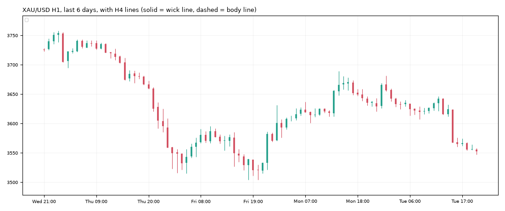

# Gold daily report: Tue 24 Nov 2026

@kaamilstudiesig · **Paper trading only (simulated, no real money).** Trading day: Mon 21:00 → Tue 21:00 UTC.

**XAU/USD 3,552.80** (-83.22 on the day) · last bar Tue 20:45 UTC · data: twelvedata_spot (+2 bars)

## Today's trades

**Opened**

| Route | Side | Entry (UTC) | Entry | Stop | Target | Why |
|---|---|---|---|---|---|---|
| trend_breakout (shadow) | SHORT | 16:00 | 3,567.89 | 3,613.41 | - | RSI 33, ADX 16, ATR $22.8, signal 15:00 UTC |
| trend_breakout+macro (shadow) | SHORT | 16:00 | 3,567.89 | 3,613.41 | - | RSI 33, ADX 16, ATR $22.8, signal 15:00 UTC |

## Open positions

| Route | Side | Since (UTC) | Entry | Stop | Now | Open R | To stop |
|---|---|---|---|---|---|---|---|
| trend_breakout+macro (shadow) | SHORT | Fri 04:00 | 3,992.90 | 4,022.32 | 3,552.80 | +14.96R | $469.52 |
| daily_trend+macro (shadow) | SHORT | Fri 20:00 | 3,882.70 | 4,043.29 | 3,552.80 | +2.05R | $490.49 |
| daily_trend | SHORT | Wed 20:00 | 3,723.39 | 3,907.21 | 3,552.80 | +0.93R | $354.40 |
| daily_trend+macro (shadow) | SHORT | Wed 20:00 | 3,723.39 | 3,907.21 | 3,552.80 | +0.93R | $354.40 |
| trend_breakout (shadow) | SHORT | Tue 16:00 | 3,567.89 | 3,613.41 | 3,552.80 | +0.33R | $60.60 |
| trend_breakout+macro (shadow) | SHORT | Tue 16:00 | 3,567.89 | 3,613.41 | 3,552.80 | +0.33R | $60.60 |

## Scorecard

Paper account (portfolio routes only): **$9,996.86** (closed -50.25, open +47.10) since 2026-10-30.

Closed trades since the start:

| Route | Trades | Win | Avg R | Total R |
|---|---|---|---|---|
| daily_trend | 1 | 0% | -1.00 | -1.00 |
| london_breakout | 5 | 80% | +0.44 | +2.20 |
| london_breakout+macro | 4 | 100% | +0.80 | +3.21 |
| trend_breakout | 6 | 50% | +1.64 | +9.84 |
| trend_breakout+macro | 5 | 40% | +1.48 | +7.38 |
| zone_v18 | 2 | 100% | +2.99 | +5.99 |

Flags (you decide, by editing `config/paper.json`): trend_breakout → flag_promote, london_breakout+macro → flag_promote, zone_v18 → flag_promote

23 closed trades so far. Nothing is meaningful before ~100.

## Tomorrow's prep

- **Daily trend bias: DOWN** (price below its 100-day average 4,191.19).
- daily_trend triggers: **long** on a 19:00 UTC close above 4,149.01 (and above the 100-day average), **short** below 3,503.98 (and below it). Now +48.83 from the low trigger, -596.20 from the high.
- Macro (23 Nov): 10y real yield 2.77% (+0.17 in 20 days), dollar index +2.39% in 20 days, VIX 26.6. Falling yields and a weaker dollar usually support gold.

**Lines the analyser sees now** (nearest first):

| TF | Kind | Side | Wick line | Body line | Touches | Distance |
|---|---|---|---|---|---|---|
| 1h | sr1 | upper | 3,607.63 | 3,601.01 | 3 | +54.83 |
| 1h | channel | upper | 3,817.88 | 3,794.82 | 3 | +265.08 |

**Watch windows (Wed 25 Nov, UTC):** London open 07:00-09:00 (fake-out risk), US data 12:30 / 13:30, NY open 13:30-14:30, rollover 21:00-22:00 (wide spreads).

---
Generated by the paper-trading bot. Simulation with modelled costs; not investment advice.
