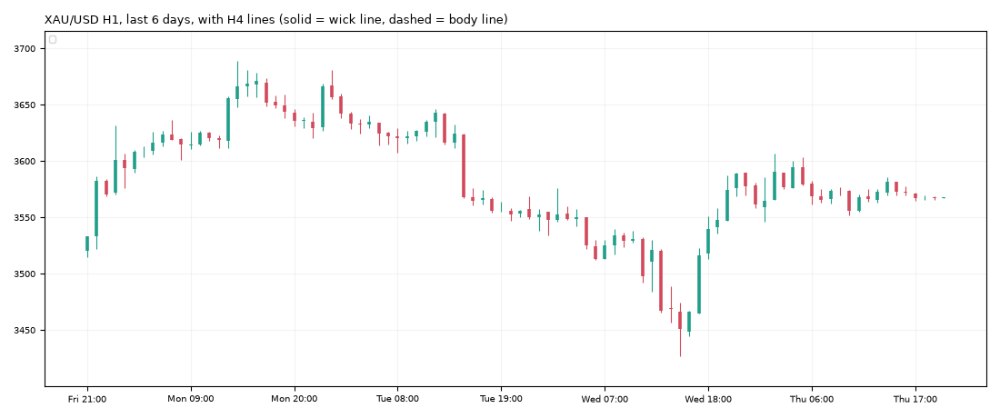

# Gold daily report: Thu 26 Nov 2026

@kaamilstudiesig · **Paper trading only (simulated, no real money).** Trading day: Wed 21:00 → Thu 21:00 UTC.

**XAU/USD 3,567.58** (-3.25 on the day) · last bar Thu 20:45 UTC · data: twelvedata_spot (+7 bars)

## Today's trades

No trades opened or closed today.

## Open positions

| Route | Side | Since (UTC) | Entry | Stop | Now | Open R | To stop |
|---|---|---|---|---|---|---|---|
| trend_breakout+macro (shadow) | SHORT | Fri 04:00 | 3,992.90 | 4,022.32 | 3,567.58 | +14.46R | $454.74 |
| daily_trend+macro (shadow) | SHORT | Fri 20:00 | 3,882.70 | 4,043.29 | 3,567.58 | +1.96R | $475.71 |
| daily_trend | SHORT | Wed 20:00 | 3,723.39 | 3,907.21 | 3,567.58 | +0.85R | $339.62 |
| daily_trend+macro (shadow) | SHORT | Wed 20:00 | 3,723.39 | 3,907.21 | 3,567.58 | +0.85R | $339.62 |

## Scorecard

Paper account (portfolio routes only): **$9,976.71** (closed -50.25, open +26.96) since 2026-10-30.

Closed trades since the start:

| Route | Trades | Win | Avg R | Total R |
|---|---|---|---|---|
| daily_trend | 1 | 0% | -1.00 | -1.00 |
| london_breakout | 5 | 80% | +0.44 | +2.20 |
| london_breakout+macro | 4 | 100% | +0.80 | +3.21 |
| trend_breakout | 7 | 57% | +1.56 | +10.90 |
| trend_breakout+macro | 6 | 50% | +1.41 | +8.44 |
| zone_v18 | 2 | 100% | +2.99 | +5.99 |

Flags (you decide, by editing `config/paper.json`): trend_breakout → flag_promote, london_breakout+macro → flag_promote, zone_v18 → flag_promote

25 closed trades so far. Nothing is meaningful before ~100.

## Tomorrow's prep

- **Daily trend bias: DOWN** (price below its 100-day average 4,181.44).
- daily_trend triggers: **long** on a 19:00 UTC close above 4,149.01 (and above the 100-day average), **short** below 3,426.48 (and below it). Now +141.10 from the low trigger, -581.42 from the high.
- Macro (25 Nov): 10y real yield 2.79% (+0.19 in 20 days), dollar index +2.09% in 20 days, VIX 28.3. Falling yields and a weaker dollar usually support gold.

**Lines the analyser sees now** (nearest first):

| TF | Kind | Side | Wick line | Body line | Touches | Distance |
|---|---|---|---|---|---|---|
| 1h | channel | lower | 3,563.73 | 3,571.09 | 3 | -3.85 |
| 1h | channel | upper | 3,577.27 | 3,561.68 | 3 | +9.69 |

**Watch windows (Fri 27 Nov, UTC):** London open 07:00-09:00 (fake-out risk), US data 12:30 / 13:30, NY open 13:30-14:30, rollover 21:00-22:00 (wide spreads).

---
Generated by the paper-trading bot. Simulation with modelled costs; not investment advice.
