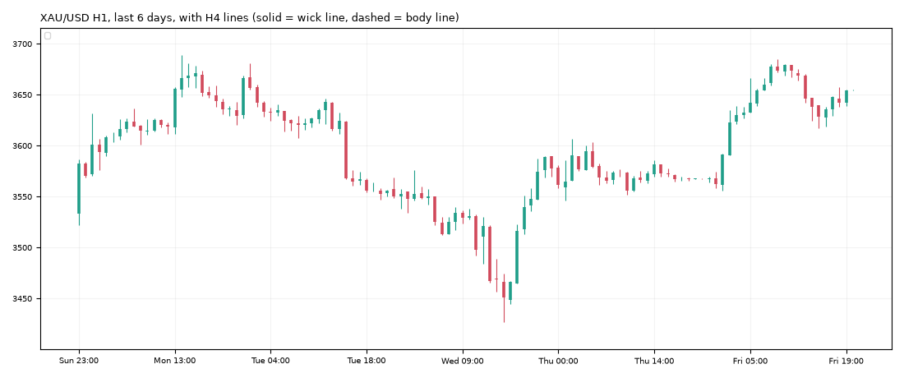

# Gold daily report: Fri 27 Nov 2026

@kaamilstudiesig · **Paper trading only (simulated, no real money).** Trading day: Thu 21:00 → Fri 21:00 UTC.

**XAU/USD 3,654.45** (+87.02 on the day) · last bar Fri 20:45 UTC · data: twelvedata_spot (+0 bars)

## Today's trades

**Closed**

| Route | Side | Entry | Exit | Result | Reason |
|---|---|---|---|---|---|
| daily_trend | SHORT | 3,723.39 | 3,671.71 | **+0.28R** ($+14) | stop |
| daily_trend+macro (shadow) | SHORT | 3,723.39 | 3,671.71 | **+0.28R** ($+14) | stop |

## Open positions

| Route | Side | Since (UTC) | Entry | Stop | Now | Open R | To stop |
|---|---|---|---|---|---|---|---|
| trend_breakout+macro (shadow) | SHORT | Fri 04:00 | 3,992.90 | 4,022.32 | 3,654.45 | +11.51R | $367.88 |
| daily_trend+macro (shadow) | SHORT | Fri 20:00 | 3,882.70 | 4,043.29 | 3,654.45 | +1.42R | $388.84 |

## Scorecard

Paper account (portfolio routes only): **$9,963.47** (closed -36.53, open +0.00) since 2026-10-30.

Closed trades since the start:

| Route | Trades | Win | Avg R | Total R |
|---|---|---|---|---|
| daily_trend | 2 | 50% | -0.36 | -0.73 |
| daily_trend+macro | 1 | 100% | +0.28 | +0.28 |
| london_breakout | 5 | 80% | +0.44 | +2.20 |
| london_breakout+macro | 4 | 100% | +0.80 | +3.21 |
| trend_breakout | 7 | 57% | +1.56 | +10.90 |
| trend_breakout+macro | 6 | 50% | +1.41 | +8.44 |
| zone_v18 | 2 | 100% | +2.99 | +5.99 |

Flags (you decide, by editing `config/paper.json`): trend_breakout → flag_promote, london_breakout+macro → flag_promote, zone_v18 → flag_promote

27 closed trades so far. Nothing is meaningful before ~100.

## Tomorrow's prep

- **Daily trend bias: DOWN** (price below its 100-day average 4,177.46).
- daily_trend triggers: **long** on a 19:00 UTC close above 4,149.01 (and above the 100-day average), **short** below 3,426.48 (and below it). Now +227.97 from the low trigger, -494.56 from the high.
- Macro (27 Nov): 10y real yield 2.73% (+0.10 in 20 days), dollar index +1.68% in 20 days, VIX 23.8. Falling yields and a weaker dollar usually support gold.

**Lines the analyser sees now** (nearest first):

| TF | Kind | Side | Wick line | Body line | Touches | Distance |
|---|---|---|---|---|---|---|
| 1h | channel | lower | 3,634.80 | 3,649.61 | 3 | -19.64 |
| 1h | sr1 | lower | 3,556.04 | 3,561.89 | 3 | -98.41 |
| 1h | box | lower | 3,551.89 | 3,561.38 | 3 | -102.56 |

**Watch windows (Mon 30 Nov, UTC):** London open 07:00-09:00 (fake-out risk), US data 12:30 / 13:30, NY open 13:30-14:30, rollover 21:00-22:00 (wide spreads).

---
Generated by the paper-trading bot. Simulation with modelled costs; not investment advice.
